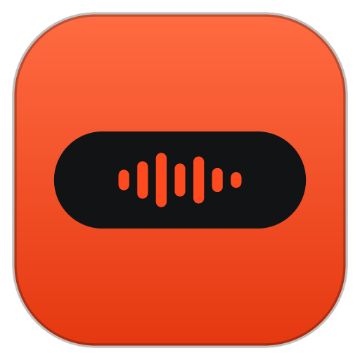

<p align="center">
  
</p>

<h1 align="center">Isla</h1>

<p align="center">
  <b>Dynamic Island untuk Windows</b>, ditulis dengan Rust.<br>
  <sub>A Dynamic Island style notch for Windows, written in Rust.</sub>
</p>

---

Isla menaruh "pulau" hitam kecil di tepi atas layar. Saat disentuh kursor, Isla membesar dan menampilkan musik, info sistem, file, dan notifikasi. Saat ada kejadian (volume, lagu baru, notifikasi, Caps Lock), Isla memunculkan HUD singkat.

Ringan: satu file exe sekitar 1 MB, tanpa runtime, sekitar 0,4% CPU saat musik diputar.

## Fitur

**Notch kecil**
- Jam + cuaca (atau baterai di laptop). Saat musik diputar, tampil album art + equalizer + **lirik sinkron**.
- Timer fokus, pengingat, atau stopwatch yang sedang berjalan.
- Titik oranye/hijau di samping notch saat mic/kamera sedang dipakai, seperti di iPhone.

**Hover → membesar, 6 tab**
| Tab | Isi |
|---|---|
| **Beranda** | Media yang diputar (album art, judul berjalan, seek, prev/play/next, ganti sumber Spotify/YouTube/…) atau jam besar + cuaca, shortcut app, timer fokus |
| **Sistem** | CPU, RAM, GPU NVIDIA (pemakaian, suhu, VRAM), unduh/unggah, volume, mic, ganti output audio, cuaca, ping + grafik |
| **Alat** | Stopwatch, pengingat cepat (5 menit–1 jam), alarm, screenshot layar penuh / pilih area |
| **Clip** | Riwayat clipboard (teks & gambar). Klik = salin lagi. Hanya di memori, isi dari password manager dilewati |
| **Shelf** | Seret file ke notch untuk disimpan sementara. Klik = buka, seret keluar = salin/pindah, klik kanan = hapus |
| **Notif** | Notifikasi Windows terbaru (Discord, WhatsApp, dll) |

Header juga menampilkan baterai earbuds/headset Bluetooth.

**HUD otomatis:** volume, mic mute/aktif, ganti output audio, lagu baru, notifikasi, Caps/Num Lock, charger, perangkat Bluetooth tersambung, timer/pengingat/alarm selesai, screenshot tersimpan, versi baru tersedia.

**Lainnya:** scroll di notch = volume · notch bisa digeser kiri/kanan · sembunyi otomatis saat fullscreen · mendukung DPI dan multi-monitor · ikon tray · jendela pengaturan.

## Pemakaian

| Aksi | Hasil |
|---|---|
| Arahkan kursor ke notch | Notch membesar |
| Scroll di atas notch | Atur volume |
| Seret area kosong notch yang membesar | Pindahkan notch kiri/kanan |
| Seret file ke notch | Simpan ke Shelf |
| Klik ikon tray / klik kanan notch | Buka pengaturan / menu |

## Pengaturan

Klik ikon **Isla** di system tray untuk membuka jendela pengaturan: autostart, monitor, posisi, ukuran, jeda hover, timer fokus, warna aksen, kota cuaca, 11 fitur ON/OFF, dan shortcut app.

Semua perubahan langsung diterapkan dan disimpan di `%APPDATA%\Isla\config.toml` (bisa juga diedit manual).

Layanan online yang dipakai (semuanya gratis, tanpa akun, dan bisa dimatikan di pengaturan):
- **Cuaca:** [Open-Meteo](https://open-meteo.com/). Isi nama kota, atau kosongkan untuk memakai lokasi Windows. Koordinat dibulatkan ke sekitar 1 km.
- **Lirik:** [LRCLIB](https://lrclib.net/). Yang dikirim hanya judul dan artis lagu.
- **Cek update:** GitHub Releases. Aktif setelah `repository` diisi di `Cargo.toml`.

## Rilis

Workflow GitHub Actions di `.github/workflows/release.yml` membangun `isla.exe` dan memasangnya ke halaman Release setiap kali tag versi di-push:

```powershell
git tag v0.1.0
git push origin v0.1.0
```

## Build

Butuh Rust (toolchain MSVC, sudah diatur di `rust-toolchain.toml`) dan Visual Studio Build Tools + Windows SDK.

```powershell
cargo build --release
.\target\release\isla.exe
```

Perintah tambahan untuk pengembangan:

```powershell
.\target\release\isla.exe --snapshot snapshots   # render semua tampilan ke PNG
.\target\release\isla.exe --write-icon assets    # buat ulang assets/isla.ico + isla.png
```

## Teknologi

- Win32 layered window + `UpdateLayeredWindow` untuk transparansi per-pixel
- [tiny-skia](https://github.com/RazrFalcon/tiny-skia) untuk menggambar, [fontdue](https://github.com/mooman219/fontdue) untuk teks (font Segoe UI sistem)
- WinRT: `GlobalSystemMediaTransportControls` (media), `UserNotificationListener` (notifikasi), `BitmapDecoder` (album art)
- Core Audio (volume, mic, output), NVML (GPU NVIDIA), IP Helper (jaringan), OLE drag & drop (shelf)

Hanya untuk Windows 10/11.
